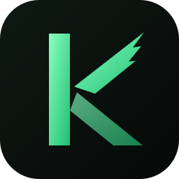

<h1 align="center">
  
  [](https://discord.gg/ТВОЙ_ИНВАЙТ)
[](https://t.me/ТВОЙ_КАНАЛ)
[](mailto:ТВОЯ_ПОЧТА@gmail.com)
  KestrelUI
</h1>

<p align="center">
  Customizable desktop environment for Windows — no accounts, no ads, no telemetry.
</p>

---

KestrelUI is a community fork of [Seelen UI](https://github.com/eythaann/seelen-ui). It keeps everything that made
Seelen great — the tiling window manager, the dock, the toolbar, widgets, themes, icon packs and wallpapers — and
removes everything that got in the way:

- **No account.** The login flow, plan tiers and the cloud vault are gone. Every feature works offline.
- **No ads.** No "Upgrade" banners, no news feed, no review nags, no Discord status.
- **No telemetry.** Nothing is sent home on startup. The only network requests are update checks and the showcase,
  both against public GitHub URLs, plus the model provider you connect the assistant to, if any.
- **Showcase.** Community setups from GitHub, installable and reversible in one click. Publish yours from the app
  with a GitHub sign-in, see [documentation/showcase.md](documentation/showcase.md).
- **Assistant.** Connect GPT, Claude, OpenRouter or any OpenAI-compatible API with your own key and ask it to
  restyle things or explain them. Changes are applied through a limited set of settings and can be undone in one
  click; API keys stay in the Windows credential vault.

## Status

Early fork. The first milestone is a clean, de-branded build at feature parity with Seelen UI 2.8.11. Then: bug
fixes, performance, and a KestrelUI-specific design and customization layer. See [ROADMAP.md](ROADMAP.md).

Compatibility: themes, widgets, plugins and icon packs built for Seelen UI keep working — the `@seelen/*` resource
ids and the `SeelenCommand` plugin API are intentionally left untouched.

## Building

Windows 10/11 only. Run `build.bat` (double-click works) and press a number in the menu, or pass the mode as an
argument. It installs whatever is missing through winget — Visual Studio Build Tools with the Windows SDK, Rust,
Node.js, Deno, Git, WebView2 — and then builds:

| menu / command          | result                                            |
| ----------------------- | ----------------------------------------------------- |
| 1 `build.bat debug`     | debug installer in `target\debug\bundle\nsis`          |
| 2 `build.bat release`   | release installer in `target\release\bundle\nsis`      |
| 3 `build.bat dev`       | run from sources with hot reload                      |
| 4 `build.bat deps`      | only install and check the build tools                |

The window stays open at the end and the full output goes to `build.log`; on failure the last lines are shown
right away.

Local release builds are unsigned and have auto-updates off.
Signed releases with auto-updates need your own key pair:

```sh
npx tauri signer generate -w kestrelui.key
```

Set `TAURI_SIGNING_PRIVATE_KEY` (+ password) and `KESTREL_PUBKEY` (the public key, base64) as repository
secrets; the release workflow embeds the public key into the binary for update and bundle-integrity checks.

## License

[GNU AGPL-3.0](LICENSE), same as upstream. KestrelUI contains code from Seelen UI, © Seelen Corp. and contributors.
See [NOTICE](NOTICE).
