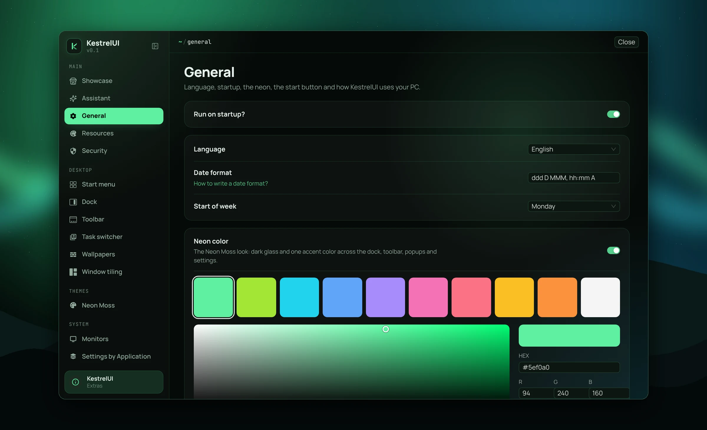
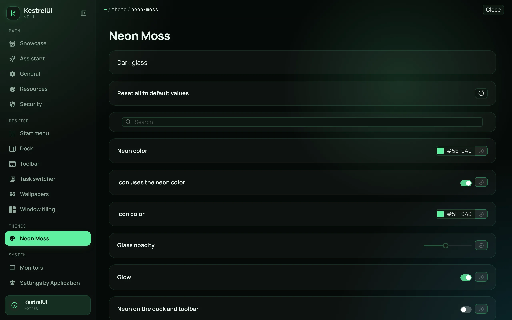
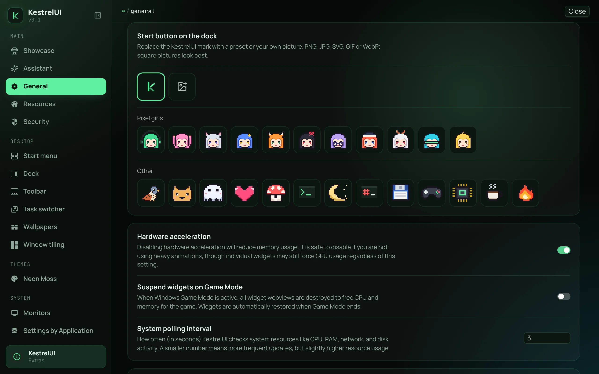
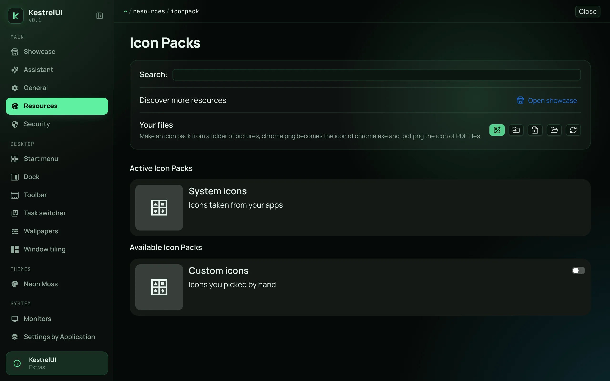
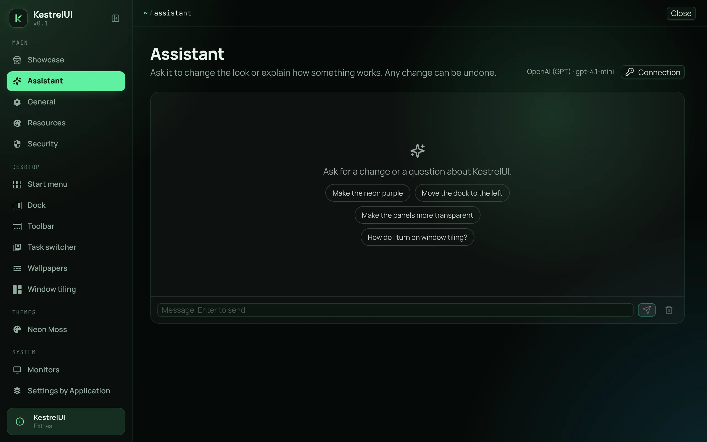
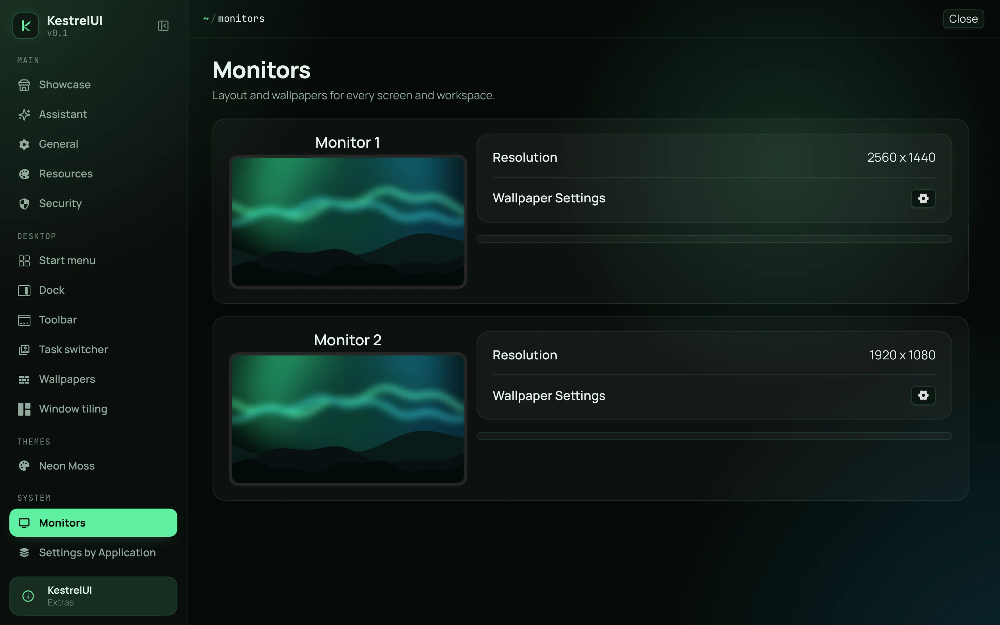
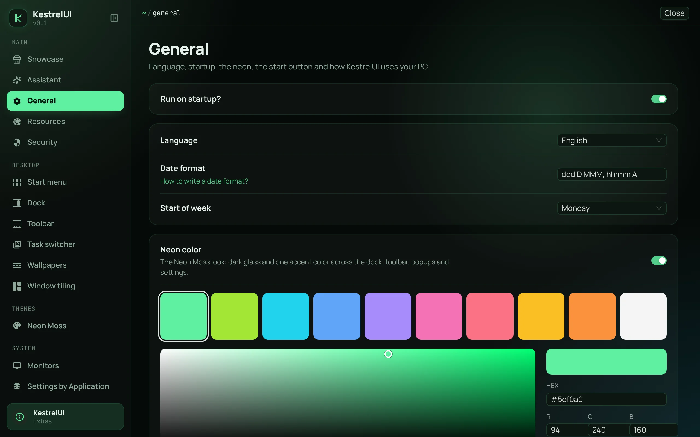

<p align="center">
  
</p>

<h1 align="center">KestrelUI</h1>

<p align="center">
  Customizable desktop environment for Windows — no accounts, no ads, no telemetry.
</p>

<p align="center">
  <a href="https://discord.gg/ycmhfnmCqh"></a>
  <a href="https://t.me/qwarwin4git"></a>
  <a href="mailto:qwarwin@gmail.com"></a>
</p>
<p align="center">
  <a href="https://github.com/Qwarwin4/KestrelUI"></a>
  <a href="LICENSE"></a>
</p>

<p align="center">
  
</p>

---

KestrelUI is a community fork of [Seelen UI](https://github.com/eythaann/seelen-ui). It keeps everything that made
Seelen great — the tiling window manager, the dock, the toolbar, widgets, themes, icon packs and wallpapers — and
removes everything that got in the way:

- **No account.** The login flow, plan tiers and the cloud vault are gone. Every feature works offline.
- **No ads.** No "Upgrade" banners, no news feed, no review nags, no Discord status.
- **No telemetry.** Nothing is sent home on startup. The only network requests are update checks and the showcase, both
  against public GitHub URLs, plus the model provider you connect the assistant to, if any.
- **Showcase.** Community setups from GitHub, installable and reversible in one click. Publish yours from the app with a
  GitHub sign-in, see [documentation/showcase.md](documentation/showcase.md).
- **Assistant.** Connect GPT, Claude, OpenRouter or any OpenAI-compatible API with your own key and ask it to restyle
  things or explain them. Changes are applied through a limited set of settings and can be undone in one click; API keys
  stay in the Windows credential vault.

## Screenshots

<table>
  <tr>
    <td width="50%"><p align="center">Neon Moss: neon color, glass, glow, neon on the dock and toolbar</p></td>
    <td width="50%"><p align="center">Start button: pixel presets or your own picture</p></td>
  </tr>
  <tr>
    <td width="50%"><p align="center">Icon packs from a folder of pictures, resources from disk</p></td>
    <td width="50%"><p align="center">Assistant over your own GPT, Claude or OpenRouter key</p></td>
  </tr>
  <tr>
    <td width="50%"><p align="center">Monitors and wallpapers, the Windows wallpaper by default</p></td>
    <td width="50%"><p align="center">General: startup, language, neon presets and color picker</p></td>
  </tr>
</table>

## Status

Early fork. The first milestone is a clean, de-branded build at feature parity with Seelen UI 2.8.11. Then: bug fixes,
performance, and a KestrelUI-specific design and customization layer. See [ROADMAP.md](ROADMAP.md).

Compatibility: themes, widgets, plugins and icon packs built for Seelen UI keep working — the `@seelen/*` resource ids
and the `SeelenCommand` plugin API are intentionally left untouched.

## Building

Windows 10/11 only. Run `build.bat` (double-click works) and press a number in the menu, or pass the mode as an
argument. It installs whatever is missing through winget — Visual Studio Build Tools with the Windows SDK, Rust,
Node.js, Deno, Git, WebView2 — and then builds:

| menu / command        | result                                            |
| --------------------- | ------------------------------------------------- |
| 1 `build.bat debug`   | debug installer in `target\debug\bundle\nsis`     |
| 2 `build.bat release` | release installer in `target\release\bundle\nsis` |
| 3 `build.bat dev`     | run from sources with hot reload                  |
| 4 `build.bat deps`    | only install and check the build tools            |

The window stays open at the end and the full output goes to `build.log`; on failure the last lines are shown right
away.

Local release builds are unsigned and have auto-updates off. Signed releases with auto-updates need your own key pair:

```sh
npx tauri signer generate -w kestrelui.key
```

Set `TAURI_SIGNING_PRIVATE_KEY` (+ password) and `KESTREL_PUBKEY` (the public key, base64) as repository secrets; the
release workflow embeds the public key into the binary for update and bundle-integrity checks.

## License

[GNU AGPL-3.0](LICENSE), same as upstream. KestrelUI contains code from Seelen UI, © Seelen Corp. and contributors. See
[NOTICE](NOTICE).
